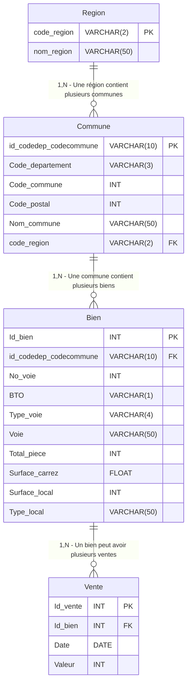

# Schéma Relationnel - Projet Laplace Immo

Le schéma relationnel est basé sur la 3ème forme normale (3NF) pour éviter les redondances et assurer l'intégrité des données. Mis à jour selon les besoins en analyse identifiés en réunion.

## Tables

- **Région** : Informations sur les régions françaises
- **Commune** : Informations sur les communes, liées à une région
- **Bien** : Détails des biens immobiliers
- **Vente** : Historique des transactions

## Diagramme du Schéma

## Explications

- **Région** : Nouvelle table ajoutée pour répondre aux besoins d'analyse par région (ex: ventes par région, prix par région).
- **Commune** : Liée à Région via code_region. Clé primaire composite maintenue.
- **Bien et Vente** : Inchangés, mais permettent les analyses requises.

Ce schéma couvre tous les besoins exprimés en réunion : analyses par région, département, commune, type de bien, etc.